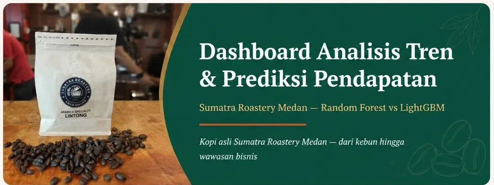

# Dashboard Analisis Tren & Prediksi Pendapatan Sumatra Roastery Medan



Aplikasi web berbasis **Streamlit** untuk menganalisis tren penjualan dan memprediksi pendapatan bulanan **Sumatra Roastery Medan** (toko bubuk kopi), dengan membandingkan dua model *machine learning*: **Random Forest** dan **LightGBM**.

- **Nama:** *putri yanti purba*
- **NIM:** *22040161*
- **Program Studi:** *Teknik Informatika*
- **Judul Skripsi:** *ANALISIS TREN DAN PREDIKSI PENDAPATAN PENJUALAN KOPI MENGGUNAKAN ALGORITMA RANDOM FOREST DAN LIGHTGBM PADA SUMATRA ROASTERY MEDAN*

---

## Fitur Utama

- Login dengan 2 peran: **Admin** dan **Pemilik/Pengelola**
- **Input Dataset**: unggah file Excel (.xlsx) dan atur proporsi data training/testing (khusus Admin)
- **Data Aktual**: tabel transaksi harian + unduh Excel
- **Analisis Tren**: grafik tren pendapatan per bulan dan per jenis kopi
- **Prediksi & Evaluasi**: hasil prediksi Random Forest dan LightGBM vs data aktual
- **Feature Importance**: fitur yang paling berpengaruh pada tiap model
- **Perbandingan Model**: evaluasi MAE, RMSE, R² dan waktu training
- **Perkiraan Bulan Berikutnya**: prediksi pendapatan bulan depan per jenis kopi
- **Kalender**: heatmap kalender dengan tampilan Bulan / Minggu / Hari
- **Laporan** (khusus Pemilik/Pengelola): laporan penjualan berkop surat, dapat diunduh dalam format **Word (.docx)** dan **PDF**

## Teknologi

- Python 3.9+
- Streamlit (antarmuka web)
- pandas, numpy
- scikit-learn (Random Forest, evaluasi model)
- LightGBM
- Plotly (grafik interaktif)
- openpyxl (baca/tulis Excel)
- python-docx dan reportlab (pembuatan laporan Word dan PDF)

## Cara Instalasi (Windows / Lokal)

1. Install **Python 3.9+** (centang *Add Python to PATH* saat instalasi).
2. Salin seluruh folder project ini ke komputer, lalu buka terminal / Command Prompt di dalam folder tersebut.
3. *(Opsional, disarankan)* Buat virtual environment:

   ```bash
   python -m venv venv
   venv\Scripts\activate
   ```

4. Install pustaka yang dibutuhkan:

   ```bash
   pip install -r requirements_local.txt
   ```

5. Jalankan aplikasi:

   ```bash
   streamlit run app.py
   ```

6. Browser akan terbuka otomatis. Jika tidak, buka alamat `http://localhost:8501`.

> **Penting:** `app.py`, `logic.py`, `login.py`, `logo.png`, `favicon.png`, gambar banner, dan `DATA_BERSIH.xlsx` harus berada **di satu folder yang sama**.

## Dataset

Dataset default adalah `DATA_BERSIH.xlsx`. Aplikasi otomatis memakai file `.xlsx` pertama yang ditemukan di folder yang sama dengan `app.py`, atau file yang diunggah lewat menu **Input Dataset**.

File Excel wajib memiliki 3 sheet berikut:

| Sheet | Isi |
|---|---|
| `Dataset Harian 2023-2025` | Transaksi: Tahun, Bulan, Jenis Kopi, Varian Kopi, Ukuran Kemasan, Harga (Rp), Jumlah Terjual, Pendapatan (Rp) |
| `Pendapatan Per Jenis Kopi` | Total pendapatan per bulan per jenis kopi |
| `Rekap Bulanan` | Total pendapatan keseluruhan per bulan |

Data yang dipakai mencakup periode **2023–2025** (36 bulan) dengan 7 jenis kopi: Arabika Gayo, Arabika Nusantara, Arabika Sumut, Grade Super, Kopi Blend, Robusta, dan Lainnya.

## Model & Evaluasi

- **Algoritma:** Random Forest Regressor dan LightGBM Regressor (masing-masing 200 pohon, `random_state=42`)
- **Target:** Total Pendapatan (Rp) per jenis kopi per bulan
- **Fitur:** Tahun, nomor bulan, jenis kopi, harga rata-rata tertimbang, pendapatan bulan sebelumnya (`lag_1`), dan kategori tren (Tinggi/Rendah)
- **Pembagian data:** berdasarkan urutan waktu (bukan acak), proporsi training/testing dapat diatur di menu Input Dataset (default 80:20)
- **Metrik evaluasi:** MAE, RMSE, R², dan waktu training

> **Catatan:** nilai harian dan mingguan di menu Kalender adalah **estimasi** hasil pembagian rata pendapatan bulanan, bukan hasil prediksi model. Model dilatih dan dievaluasi pada level bulanan.

## Akun Login Bawaan

| Peran | Username | Password |
|---|---|---|
| Admin | `Admin` | `admin123` |
| Pemilik/Pengelola | `pemilik` | `pemilik123` |

Akun dapat diubah pada variabel `CREDENTIALS` di file `login.py`.

**Perbedaan hak akses:** menu **Input Dataset** (unggah file) hanya untuk Admin, sedangkan menu **Laporan** hanya tampil untuk Pemilik/Pengelola.

## Struktur Folder

| File | Keterangan |
|---|---|
| `app.py` | Tampilan (UI) dashboard dan navigasi menu |
| `logic.py` | Pemuatan data, training model, prediksi bulan depan, pembuatan laporan Word/PDF |
| `login.py` | Halaman login dan pengaturan akun |
| `DATA_BERSIH.xlsx` | Dataset penjualan 2023–2025 |
| `requirements_local.txt` | Daftar pustaka Python |
| `logo.png` | Logo Sumatra Roastery (sidebar dan kop laporan) |
| `favicon.png` | Ikon tab browser |
| `banner_kopi.jpg` / `preview_banner_dashboard.jpg` | Banner halaman Dashboard |

## Mengubah Identitas Laporan

Nama usaha, alamat, telepon, website, dan nama penanda tangan laporan dapat diubah di bagian atas file `logic.py` (variabel `BUSINESS_NAME`, `BUSINESS_ADDRESS`, `BUSINESS_PHONE`, `SIGNER_NAME`, dan seterusnya).

---

© 2026 Sumatra Roastery Medan
